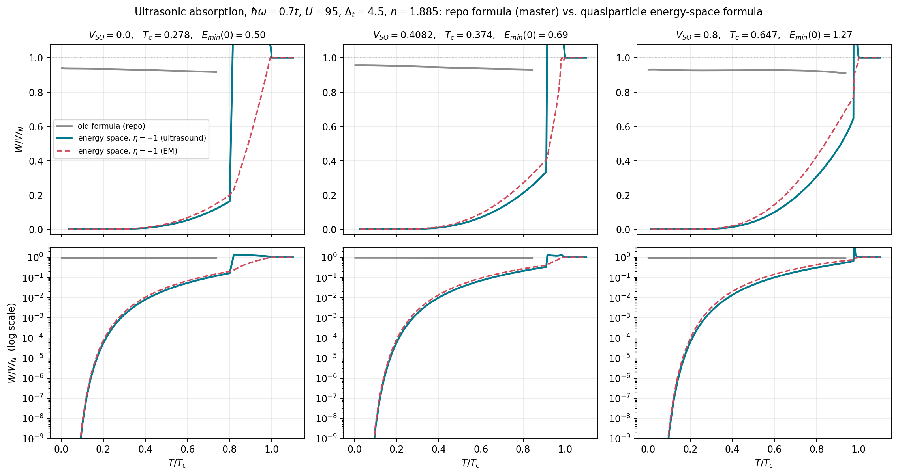

# Review of the ultrasonic-absorption code and an energy-space replacement

Repo reviewed: `AmirhoseynpowAsghari/power-absorbed-in-the-presence-of-external-time-dependent-perturbation`, branch **master**, commit `cda0d56` ("ultrasonic"; line numbers refer to it).
(The default branch `main` has the same `absorption.py` but other stage-1 parameters; everything below is for `master`.) Dimensionless units (t = ħ = k_B = 1), as in your code.
Files of this review are in the folder `asghari_fix/`.

## 1. Summary

**The central problem** is in `project/ultrasonic/absorption.py`. The integration variable `E_grid` is the *normal-state band energy* ε
(the DOS `gE_table` is the DOS of ε_ks), energy conservation is imposed on it (`Ep_grid = E_grid + hbar*omega`, line 34), and the thermal factor is the
*normal-state* Fermi function of ε (`fermi_vec(·, T, mu)`, line 71). Superconductivity enters only through the coherence bracket with one constant gap.
The golden rule needs energy conservation and occupation for the **quasiparticle** energy E = sqrt(ξ² + Δ̄²) ≥ E_min, with f(E) = 1/(e^(E/T)+1) (no μ) and the
quasiparticle density of states (the Jacobian dε/dE). Consequence, visible in your saved results: W/W_N stays at 0.91 – 0.96 at *every* temperature and never
goes to zero as T → 0 (the `T < 1e-4 → 0.0` shortcut and the `2Δ > ħω` cut-off hide exactly this).

**The fix keeps the k-dependence** (what you asked for): every k-sum is a sum over ε_ks with the normal DOS N(ε), and the gap stays
Δ̄(ε) = Δ⁰ − Δˢ ε/4t instead of a k-average. For a given quasiparticle energy E there are two band energies ε_±(E) (both must lie inside the band),
and the delta function is solved on them with the Jacobian |dε/dE| = E / (sqrt(1+b²) sqrt(E²−E_min²)), b = Δˢ/4t. Both channels are included:
quasiparticle scattering and pair creation (zero below 2E_min, so no domain-of-validity cut is needed).

**What changes** (V_SO, T/Tc, ħω = 0.7, your stage-1 parameters U = 95, Δt = 4.5, n = 1.885; η = +1 ultrasound, η = −1 EM; "old" = the repo's saved results):

| V_SO | T/Tc | W/W_N, old (repo) | W/W_N, new, η=+1 | W/W_N, new, η=−1 |
|---|---|---|---|---|
| 0.0 | 0.3 | 0.9318 | 1.42e-03 | 1.88e-03 |
| 0.0 | 0.5 | 0.9250 | 2.42e-02 | 3.12e-02 |
| 0.0 | 0.7 | 0.9180 | 9.90e-02 | 1.24e-01 |
| 0.0 | 0.9 | 0.9167 | 1.27e+00 | 5.48e-01 |
| 0.4082 | 0.3 | 0.9485 | 1.73e-03 | 2.40e-03 |
| 0.4082 | 0.5 | 0.9406 | 3.13e-02 | 4.22e-02 |
| 0.4082 | 0.7 | 0.9343 | 1.29e-01 | 1.69e-01 |
| 0.4082 | 0.9 | 0.9304 | 3.23e-01 | 3.93e-01 |
| 0.8 | 0.3 | 0.9257 | 2.10e-03 | 3.17e-03 |
| 0.8 | 0.5 | 0.9270 | 4.39e-02 | 6.38e-02 |
| 0.8 | 0.7 | 0.9256 | 1.87e-01 | 2.64e-01 |
| 0.8 | 0.9 | 0.9136 | 4.68e-01 | 6.17e-01 |

Values above 1 are the pair-breaking channel, which opens when 2E_min(T) = ħω (a step, as at any BCS edge; see below).



| V_SO | T_c: your stage 1 / my solver | Δ_eff(0) (your gap) | E_min(0) (true) | μ(T→0): your stage 2 / self-consistent / normal | your sweep stops at T/Tc | true pair-breaking onset T/Tc |
|---|---|---|---|---|---|---|
| 0.0 | 0.2861 / 0.2781 | 0.444 | 0.501 | 3.432 / 3.330 / 3.310 | 0.74 | 0.81 |
| 0.4082 | 0.3808 / 0.3736 | 0.549 | 0.688 | 3.732 / 3.629 / 3.581 | 0.84 | 0.91 |
| 0.8 | 0.6494 / 0.6467 | 0.854 | 1.273 | 4.454 / 4.417 / 4.263 | 0.94 | 0.98 |

**Validation** (`validate_qp.py`, log in `validate_qp_output.txt`):

| test | result |
|---|---|
| A. Δ → 0: scattering + pair creation must equal the normal-state absorption (checks both channels and all prefactors) | worst deviation 2.6e-03 |
| B. textbook BCS limit (flat DOS, constant gap, ω → 0, η=+1): W_s/W_n = 2 f(Δ) | worst relative deviation 8.1e-05 |
| D2. flat DOS with energy-dependent gap, pair channel open: analytic branches/Jacobians vs a 2-D energy-grid sum | worst relative deviation 4.6e-04 |
| D. all pairs of (k,s) states on a k-grid, with the helicity overlap ½(1+ss′cosΔθ), vs the energy-space formula; V_SO = 0.4082, T/Tc = 0.7 | brute force 0.119 / 0.122 / 0.124 / 0.124 for N = 64 / 96 / 128 / 160; energy space 0.131 / 0.129 / 0.127 for DOS smoothing 0.04 / 0.02 / 0.01 |
| D. same, T/Tc = 0.96 (pair channel just open) | agree to 1.7 % |
| C. limits: W/W_N → 0 exponentially as T → 0, → 1 at T_c | satisfied (table above and figure) |

Test D also shows that the helicity overlap averages to exactly ½ over constant-energy contours, so the energy-space result *is* the all-pairs sum including
the helicity form factor of the previous note. The residual 2–5 % in the lattice comparison is regularisation and finite-grid sampling (both sequences converge towards each other), not the formula.

## 2. Findings

### A. Conceptual (they change the results)

| # | where | problem | fix |
|---|---|---|---|
| A1 | `absorption.py` 34, 37, 54–61, 71–72; `lecture_note…md` §1; the diagnostics `visualize_integrand.py`, `phase_space_cutoff_test_for_repo.py`, `diagnose_full_VSO.py`, `dashboard.py`, `visualize_phase_space_cutoff.py` (they copy or call `compute_W` / `fermi_vec`) | band energy used as if it were the quasiparticle energy (see Summary): no BCS DOS, no f(E_qp), energy conservation on ε. `physics_ua.fermi_qp` (line 23, no μ) already exists but is not used by `compute_W` | `qp_absorption.absorption` |
| A2 | `absorption.py` 42–50; `physics_ua.py` 63–76 (`pairbreaking_valid`); `scanning_ua.py` 79–84, 161–167; `check_pairbreaking_*.py`; `absorption_u.py` | `T<1e-4 → 0`, NaN / stop when 2Δ_eff ≤ ħω. The threshold is 2E_min, not 2Δ_eff (table above: your sweeps stop at T/Tc = 0.74 / 0.84 / 0.94, the true onset is 0.81 / 0.91 / 0.98), and the missing pair channel is the real reason | include the pair channel; no cut needed |
| A3 | `absorption.py` 60–61, 67 | `xi_abs` = \|ξ\| discards the sign of ξ (the lecture note has the signed ξξ′; the paper's own step ε−μ = +√(E²−Δ²) has the same effect); wrong whenever ξξ′ < 0 (see `Energy_space_mathematics.pdf` §5) | the sign is carried by the branch ε_±(E) |
| A4 | `absorption.py` 69 (and `absorption_u.py`); note §1 | `+ η Δ²/(EE′)`. With M = B(uu′ − ηvv′) the coherence factor is ½[1 + ξξ′/EE′ − η ΔΔ′/EE′]; the code's η=+1 is the electromagnetic (case II, coherence-peak) factor | sign and ΔΔ′ (signed, not Δ²) |
| A5 | `gap_equations.py` 75–81; `sc_loader.py` (`'Delta0'` := Δ_eff); `physics_ua.py` 44–61 (`Delta_T`); `scanning_ua.py` 77 | one gap Δ_eff(T) for all k, Δ_eff = ⟨\|Δ̄\|⟩. The fitted shape (1−(T/Tc)^p)^q you introduced is a good improvement of the T-dependence, but the gap is still k-independent, whereas Δ̄(ε) runs from about +1.4 to −0.9 across the band (V_SO = 0.41) and changes sign; E_min is 13 – 49 % larger than Δ_eff (table above). Effect of the k-average alone, inside the *corrected* formula (same code with Δˢ = 0, Δ⁰ = Δ_eff; V_SO = 0.41): W/W_N changes by ×2.03 at T/Tc = 0.3, ×1.24 at T/Tc = 0.5, ×1.04 at T/Tc = 0.7, ×3.67 at T/Tc = 0.9. So most of the old-vs-new difference comes from A1, but the gap average shifts E_min and the pair-breaking threshold and matters at low T | `sc_state_vs_T` (self-consistent Δ⁰(T), Δˢ(T), μ(T)) |
| A6 | `physics_ua.py` 78–135 (`compute_electron_density`, `find_mu`); `scanning_ua.py` 86, 88–90 | μ(T) from the number equation with the constant gap (table above: 3.73 vs 3.63 self-consistent at V_SO = 0.41), and the *same* μ in W_N. W_N must use the normal-state μ_N(T) at the same filling. Effect on the ratio at V_SO = 0.41: T/Tc=0.3: 0.00173 (μ_N) vs 0.00183 (μ_SC); T/Tc=0.5: 0.0313 (μ_N) vs 0.0328 (μ_SC); T/Tc=0.7: 0.129 (μ_N) vs 0.134 (μ_SC); T/Tc=0.9: 0.323 (μ_N) vs 0.327 (μ_SC) | μ_N(T) from `Model.mu_normal` |
| A7 | `sc_params/solvers.py` 43–45, 64–66 (latent) | `abs(sol[0])`, `abs(sol[1])`: only the overall sign of (Δ⁰, Δˢ) is a gauge, the relative sign is physical. Harmless here (Δ⁰Δˢ > 0 at U = 95), but for parameter sets with a negative relative sign (I found one at U = 45) it silently changes the solution and the node of Δ̄ | store signed values |

### B. Numerical / housekeeping

| # | where | problem |
|---|---|---|
| B1 | `dos_ua.py` 24–25 | prefactor 1/(π^1.5 σ t) (as in HHM Eq. 18) with `norm = dk²/(2π)²` gives ∫g dE = 0.643 instead of 2 (a Gaussian representation of δ needs 1/(√π σ t)). Ratios are unaffected, absolute values are |
| B2 | `kgrid_ua.py` 11–15; `sc_params/kgrid.py` 10–11; `parameters_tc.py` 17 (`Nk = 80`) | `linspace(-π, π, N)` contains both ±π; `linspace(0, π, Nk)` gives full weight to the mirror-plane points; 80 × 80 is coarse. My solver on a fine midpoint grid differs from your stage 1 by +2.9 % / +1.9 % / +0.4 % in T_c at V_SO = 0 / 0.41 / 0.8; Δ⁰, Δˢ within 2 % |
| B3 | README (U/t = 75, "U = −75t" in titles) vs `parameters_tc.py` (`U_over_t = 95`, matches the paper's U = 95t V_SO scan) | the gap equations use +U (repulsive, as in HHM); please make README, titles and parameters agree |
| B4 | `parameters_u.py` (stage 3, master) | V_SO = 0, n = 0.8, U ∈ [35, 60]; the README says V_SO = 0.4, n = 1.885, U ∈ [75, 125]; `ultrasonic_U/results/` mixes U = 15 … 125. I did not review stages 3–4 beyond noting they use the same `compute_W` |
| B5 | `absorption.py` 74 | `mask = abs(E_grid) > eps` has no meaning for a band-energy grid |
| B6 | `absorption.py` 84, `scanning_ua.py` 90 | `abs(W/WN)` hides sign errors; define the thermal factor as f(E) − f(E+ħω) ≥ 0 and assert positivity |

### C. Physics remarks

* **C1 – the lecture note.** Its explanation of the structure of W/W_N versus V_SO (g(E)g(E+ħω) sampled in the window [μ, μ+ħω] near a Rashba band edge) is a property of the old integrand (A1), not of the physics.
  Your old curves (repo, T/Tc = 0.3 … 0.7) have a broad maximum near V_SO ≈ 0.5. With the corrected formula, W/W_N at fixed T/Tc is smooth and monotonic in V_SO, dominated by exp(−E_min/T):

| T/Tc | old formula: range over V_SO | new, V_SO = 0 | new, V_SO = 0.4 | new, V_SO = 0.8 |
|---|---|---|---|---|
| 0.3 | 0.926 – 0.953 (maximum at V_SO = 0.51) | 1.42e-03 | 1.72e-03 | 2.10e-03 |
| 0.5 | 0.925 – 0.946 (maximum at V_SO = 0.52) | 2.42e-02 | 3.10e-02 | 4.39e-02 |
| 0.7 | 0.918 – 0.941 (maximum at V_SO = 0.56) | 9.90e-02 | 1.28e-01 | 1.87e-01 |
| 0.9 | 0.914 – 0.936 (maximum at V_SO = 0.60, valid only for V_SO ≥ 0.60) | 1.27e+00 | 3.19e-01 | 4.68e-01 |

  The only sharp feature is at T/Tc = 0.9: a step between V_SO = 0.35 (W/W_N = 1.30) and 0.40 (0.32), where 2E_min(T) crosses ħω (pair-breaking onset; broadening by a finite quasiparticle lifetime would round it). I have not repeated the U scan.
* **C2 – q and the sums.** The corrected code keeps the paper's assumptions: constant B, unrestricted sums over k and k′ (momentum not conserved: dirty limit; the helicity overlap averages to ½), ħω = 0.7 as a model frequency (as sound it would need q·a ≈ 43, outside the zone).
  Since ħω is comparable to 2E_min here, the pair channel matters near T_c; for ultrasound with ħω ≪ 2E_min only the scattering part (the textbook quantity) survives.

## 3. The energy-space formulas (what `qp_absorption.py` computes)

With ξ = ε−μ, Δ̄(ε) = Δ⁰ − Δˢε/4t, E = sqrt(ξ²+Δ̄²), f(E) = 1/(e^(E/T)+1), N(ε) the normal DOS (∫N = 2, both helicities),
C = ½[1 + ξξ′/EE′ − ηΔ̄Δ̄′/EE′] and C_p = ½[1 − ξξ′/EE′ + ηΔ̄Δ̄′/EE′]:

```
S_sc   = ∫dε_b N(ε_b) Σ_± N(ε_a^±) [E_a / (sqrt(1+b²) sqrt(E_a²−E_min²))] C      [f(E_b) − f(E_a)],   E_a = E_b + ħω
S_pair = ∫dε_b N(ε_b) Σ_± N(ε_a^±) [E_a / (sqrt(1+b²) sqrt(E_a²−E_min²))] C_p [1 − f(E_a) − f(E_b)],  E_a = ħω − E_b,  E_b < ħω/2
S_N    = ∫dε   N(ε) N(ε+ħω) [f_N(ε) − f_N(ε+ħω)],           f_N with the normal-state μ_N(T)
W/W_N  = (S_sc + S_pair) / S_N
ε_a^± = ε* ± sqrt(E_a²−E_min²)/sqrt(1+b²),   ε* = (μ + bΔ⁰)/(1+b²),   E_min = |Δ⁰ − bμ|/sqrt(1+b²),   b = Δˢ/4t,   both roots must satisfy |ε| ≤ W
```

Implementation note: in `absorption()` the summation variable of the state b is the band energy ε_b on the grid `dos.eps_i` (all of [−W, W]); the state a is eliminated by the delta function. This is an exact change of variables of the integral over the quasiparticle energy, ∫dE Σ_σ 𝒩_σ(E) … over [E_min, E_max] with 𝒩_σ(E) = N(ε_σ(E)) E/(sqrt(1+b²) sqrt(E²−E_min²)) and E_max = max(E(−W), E(+W)) (not ∞, since there are no states beyond the band). `absorption_E()` implements that literal E-form; the two agree to 2·10⁻⁴ (scattering) and 2·10⁻³ (pair creation), see `verify_three_points.py`.

Derivation and the band test are in `Delta_of_E_derivation.pdf`; the coherence factors (and the helicity overlap) in `Helicity_matrix_element.pdf`.

## 4. How to plug it into your code (stages 2 and 4)

Add `qp_absorption.py` and `solve_gap.py` to `project/ultrasonic/` (numpy + scipy only). In `scanning_ua.py` replace the body of the temperature loop
(lines 76–98, and the analogous block in `vso_scan`) by

```python
from qp_absorption import RashbaDOS, absorption, sc_state_vs_T
from solve_gap import Model
m   = Model(U=95.0, dt=4.5, n=n_target, VSO=VSO, Nk=1200)
dos = RashbaDOS(VSO, Nk=1200)
Tc, Ts, D0, Ds, mu, muN = sc_state_vs_T(m, fracs)               # self-consistent Delta0(T), Delta_s(T), mu(T), mu_N(T)
for T, d0, ds, mu_, mun in zip(Ts, D0, Ds, mu, muN):
    ratio = absorption(dos, T, omega, d0, ds, mu_, mun, eta=eta)["ratio"]     # eta = +1 ultrasound, -1 EM
```

`physics_ua.Delta_T`, `find_mu`, `pairbreaking_valid`, `absorption.compute_W` and the `T<1e-4` shortcut are then no longer needed.
If you prefer to keep your own stage-1 solver, it must store signed Δ⁰(T), Δˢ(T) and μ(T) (A7) instead of Δ_eff only, and use a finer, midpoint k-grid (B2).

## 5. Reproduce

```
python3 validate_qp.py                       # tests A–D2 (about 1 min)
python3 compare_old_new.py <path to project/ultrasonic/results>     # old vs new, writes the two figures
python3 run_new_only.py 95                   # corrected curves only, for any U
python3 verify_three_points.py              # integration variable/limits, absence of q, energy-dependent gap (direct checks on the code)
python3 make_report.py                       # regenerates this file
```
